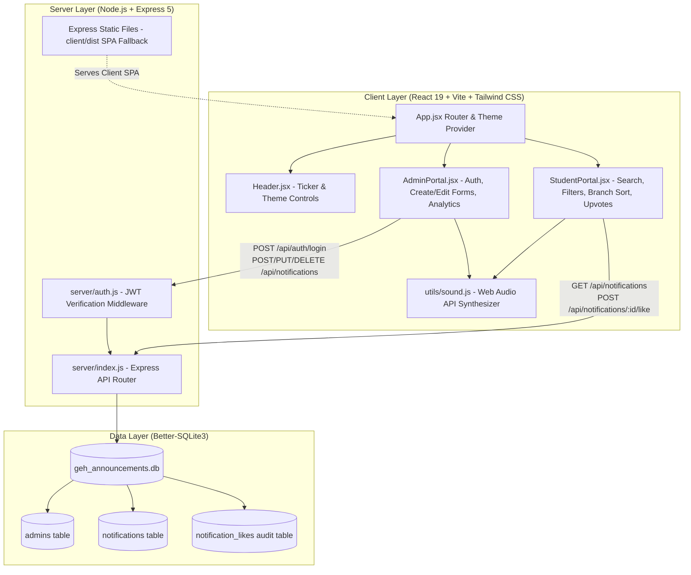

# 🏛️ Government Engineering Hassan (GEH)
### Campus Announcement & Notification Bulletin Portal

[](https://react.dev/)
[](https://vitejs.dev/)
[](https://tailwindcss.com/)
[](https://nodejs.org/)
[](https://expressjs.com/)
[](https://github.com/WiseLibs/better-sqlite3)
[](#retro-90s-sensory--aesthetic-design)
[](#-author--acknowledgments)
[](LICENSE)

An authentic **Retro 90s-styled (Windows 95/Netscape aesthetic)** full-stack campus announcement and circular portal engineered for **Government Engineering Hassan (GEH)**. It features zero-friction instant access for students and secure, authenticated circular publishing and notice lifecycle administration for college authorities across all five engineering departments and general college administrations.

---

## 📑 Table of Contents

1. [🚀 Quick Start & Running Guide](#-quick-start--running-guide) *(Start Here)*
   - [Prerequisites](#1-prerequisites)
   - [Installation](#2-installation)
   - [Option A: Running in Development Mode](#3-running-in-development-mode-recommended)
   - [Option B: Running in Production Mode (Single Port)](#4-running-in-production-mode-single-port)
   - [Default Administrator Credentials](#5-default-administrator-credentials)
   - [Available NPM Scripts](#6-available-npm-scripts)
   - [Environment Variables](#7-environment-variables)
   - [Troubleshooting & FAQs](#8-troubleshooting--faqs)
2. [📖 Detailed Project Description](#-detailed-project-description)
   - [Problem Statement & Background](#problem-statement--background)
   - [Supported Branches & Departments](#supported-branches--departments)
   - [Dual Portal Architecture](#dual-portal-architecture)
   - [Student Portal Features](#student-portal-features)
   - [Administration Portal Features](#administration-portal-features)
   - [Retro 90s Sensory & Aesthetic Design](#retro-90s-sensory--aesthetic-design)
3. [🏗️ Technical Architecture & System Design](#️-technical-architecture--system-design)
   - [Architecture Diagram](#architecture-diagram)
   - [Frontend Architecture](#frontend-architecture)
   - [Backend Architecture](#backend-architecture)
   - [Database Schema & Query Optimization](#database-schema--query-optimization)
4. [📡 REST API Documentation](#-rest-api-documentation)
   - [Public Endpoints (Students)](#public-endpoints-students)
   - [Authentication Endpoints](#authentication-endpoints)
   - [Protected Endpoints (Administration)](#protected-endpoints-administration)
5. [📁 Directory Structure](#-directory-structure)
6. [🛡️ Security & Performance Highlights](#️-security--performance-highlights)
7. [👨‍💻 Author & Acknowledgments](#-author--acknowledgments)

---

# 🚀 Quick Start & Running Guide

Follow these step-by-step instructions to get the application up and running locally on your machine in under 2 minutes.

### 1. Prerequisites

Make sure the following runtimes are installed on your workstation:
- **Node.js**: `v18.0.0` or higher (`v20.x` LTS recommended). Verify with:
  ```bash
  node -v
  ```
- **npm**: `v9.0.0` or higher. Verify with:
  ```bash
  npm -v
  ```

---

### 2. Installation

Clone or extract the repository, open your terminal in the project root directory, and install both root and client dependencies:

```bash
# Step 1: Navigate to the project root
cd clgbootcamp

# Step 2: Install backend and root dependencies
npm install

# Step 3: Install frontend dependencies inside the client directory
npm --prefix client install
```

> **Note for Windows users**: `better-sqlite3` bundles precompiled native binaries for major Node and OS versions, requiring no external build tools.

---

### 3. Running in Development Mode (Recommended)

In development mode, the Express backend API runs on port `5000` and the Vite React development server runs on port `5173` with hot module replacement (HMR) and automatic API proxying.

You can launch both services using **two separate terminal windows**:

#### Terminal 1 — Start the Backend Server:
```bash
npm run server
```
*Output confirmation:*
```text
🏛️  GEH Announcement Portal Backend Started
📍  Server URL: http://localhost:5000
🔑  Default Admin: "admin" / "admin123"
```

#### Terminal 2 — Start the Frontend Client:
```bash
npm run client
```
*Output confirmation:*
```text
  VITE v8.3.4  ready in 240 ms

  ➜  Local:   http://localhost:5173/
  ➜  Network: use --host to expose
```

👉 **Open your browser and navigate to:** [`http://localhost:5173`](http://localhost:5173)

---

### 4. Running in Production Mode (Single Port)

If you prefer to build the frontend and serve both the API and client from a **single port (`5000`)**:

```bash
# Step 1: Build the optimized React frontend bundle
npm run build

# Step 2: Launch the unified production server
npm start
```

👉 **Open your browser and navigate to:** [`http://localhost:5000`](http://localhost:5000)

The server automatically detects the `client/dist` directory and serves the compiled Single Page Application (SPA), while handling API calls under `/api/*` and supporting client-side routing fallbacks.

---

### 5. Default Administrator Credentials

The SQLite database is automatically created and seeded with a default administrative account upon first launch:

| Field | Default Value | Notes |
| :--- | :--- | :--- |
| **Username** | `admin` | Department: Administration |
| **Password** | `admin123` | Encrypted using bcrypt |
| **Role** | `superadmin` | Full CRUD permissions |
| **Access URL** | Switch to the **Administration** tab in the UI | No manual URL routing needed |

> 🔒 *In production, passwords should be altered using environment variables or administrative password reset routines.*

---

### 6. Available NPM Scripts

From the root project directory, the following commands are available:

| Command | Action |
| :--- | :--- |
| `npm run server` | Starts the Express API backend (`server/index.js`) on port 5000. |
| `npm run client` | Launches the React Vite frontend development server on port 5173 with HMR. |
| `npm run build` | Compiles and optimizes the React frontend into static assets in `client/dist`. |
| `npm start` | Runs the production backend (serves API and `client/dist` if built). |
| `npm run dev` | Alias to start the backend server. |
| `npm --prefix client run lint` | Runs the fast Oxlint linter on the frontend codebase. |

---

### 7. Environment Variables

The backend works out-of-the-box with zero configuration. You can optionally create a `.env` file in the project root to override defaults:

```ini
# Server Port (Default: 5000)
PORT=5000

# JSON Web Token Secret Key
JWT_SECRET=geh_super_secret_bulletin_jwt_key_2026

# Node Environment ('development' or 'production')
NODE_ENV=development
```

---

### 8. Troubleshooting & FAQs

<details>
<summary><b>Q1: Port 5000 or 5173 is already in use</b></summary>

- If port 5000 is occupied, set an alternate port in your terminal before launching:
  - **PowerShell (Windows)**: `$env:PORT=5050; npm run server`
  - **Bash (Linux/macOS)**: `PORT=5050 npm run server`
- Note: If you change the server port, update the target in [`client/vite.config.js`](file:///v:/Projects/5th_Sem/Hackathons/clgbootcamp/client/vite.config.js) accordingly.
</details>

<details>
<summary><b>Q2: Where is the SQLite database file stored?</b></summary>

- The SQLite database is created automatically at [`server/geh_announcements.db`](file:///v:/Projects/5th_Sem/Hackathons/clgbootcamp/server/geh_announcements.db).
- WAL mode files (`.db-wal` and `.db-shm`) may temporarily appear next to it; these ensure high-performance concurrent reads and writes.
- To reset the database to sample seed announcements, simply delete `geh_announcements.db` and restart the server.
</details>

<details>
<summary><b>Q3: Do I hear sounds when clicking buttons or upvoting?</b></summary>

- Yes! The app incorporates an authentic 90s Web Audio synthesizer (click sounds, login fanfare, error chords, and 8-bit Mario coin upvote chimes).
- You can mute or unmute sounds anytime using the **Sound Toggle (🔊/🔇)** button in the top system menu bar.
</details>

---

# 📖 Detailed Project Description

### Problem Statement & Background

**Government Engineering Hassan (GEH)** is a premier state engineering institution affiliated with Visvesvaraya Technological University (VTU), Karnataka. With thousands of students enrolled across multiple engineering departments, communicating official notices, examination schedules, campus placement drives, departmental symposiums, and emergency circulars traditionally suffered from fragmented channels (WhatsApp groups, physical cork noticeboards, and scattered PDF circulars).

The **GEH Campus Announcement Portal** was created to centralize, categorize, and democratize access to campus notifications. It bridges the gap between college administration and the student body through a responsive web portal combining **modern full-stack web standards** with an unmistakable **retro 1990s Windows 95 aesthetic**.

---

### Supported Branches & Departments

The portal supports all five primary academic disciplines at GEH, plus college-wide general circulars:

| Branch Code | Branch Name | Scope |
| :--- | :--- | :--- |
| **General** | College-Wide / General Administration | Applicable to all students, faculty, and campus staff |
| **EC** | Electronics & Communication Engineering | Departmental labs, IEEE events, hardware symposiums |
| **AI&ML** | Artificial Intelligence & Machine Learning | Coding hackathons, ML bootcamps, dataset releases |
| **CIVIL** | Civil Engineering | Survey camps, structural workshops, site visit notices |
| **Mech** | Mechanical Engineering | CAD/CAM workshops, SAE automotive club, industrial tours |
| **css** | Computer Science & Engineering *(css)* | Placement drives, open source clubs, lab schedules |

---

### Dual Portal Architecture

The application implements two distinct operating portals within a unified interface:

```
                  ┌──────────────────────────────────────────────┐
                  │    GEH Campus Announcement System Entry      │
                  └──────────────────────┬───────────────────────┘
                                         │
                 ┌───────────────────────┴───────────────────────┐
                 ▼                                               ▼
   ┌───────────────────────────┐                   ┌───────────────────────────┐
   │      STUDENT PORTAL       │                   │   ADMINISTRATION PORTAL   │
   ├───────────────────────────┤                   ├───────────────────────────┤
   │ • Zero Login Required     │                   │ • JWT & Bcrypt Protected  │
   │ • Instant Notice Browsing │                   │ • Create New Notices      │
   │ • Keyword Search          │                   │ • Edit / Update Notices   │
   │ • Branch & Priority Filter│                   │ • Expiry / Permanent Flag │
   │ • Branch Sorting          │                   │ • Delete Outdated Circulars│
   │ • Student Upvote / Likes  │                   │ • Real-time Stats & Audit │
   │ • Share & Print Modal     │                   │ • Role: Superadmin / HODs │
   └───────────────────────────┘                   └───────────────────────────┘
```

---

### Student Portal Features

The Student Portal offers zero-friction accessibility with zero registration barriers:
1. **Public Zero-Login Access**: Students can immediately view notices from any mobile, tablet, or desktop browser without logging in.
2. **Real-time Title & Content Search**: Instant debounce-free filtering across titles, descriptions, and publisher names.
3. **Multi-Branch Filtering**: Clickable tabs to isolate notices for specific branches (`General`, `EC`, `AI&ML`, `CIVIL`, `Mech`, `css`) or view all combined.
4. **Priority Filtering**: Filter circulars by severity:
   - 🚨 **Urgent**: Critical examination dates, immediate fee deadlines, hall ticket issuances.
   - ⚠️ **High**: Placement drives, department symposiums, workshop schedules.
   - 📌 **Medium**: Routine club meetings, sports events, cultural fests.
   - ℹ️ **Low**: Informational notices, lost & found, general reminders.
5. **Branch Sorting**: Custom SQL-backed sorting that groups and sequences notices according to branch name, date published, priority weight, or student upvote popularity.
6. **Democratic Student Upvotes (Priority Booster)**:
   - Students can click the **Upvote / Like** button on any announcement.
   - Upvotes dynamically boost notice prominence and priority across campus.
   - Each vote triggers a retro confetti burst and an 8-bit Web Audio coin sound.
   - Client-side device fingerprinting and server-side relational auditing (`notification_likes` table) prevent duplicate spam votes.
7. **Notice Detail Modal**: Full view modal with formatted descriptions, publisher details, validity dates, direct clipboard share link, and browser print format.
8. **Active vs. Expired Toggle**: Archive checkbox allowing students to view historical or expired notices for retrospective verification.

---

### Administration Portal Features

The Administration Portal empowers designated faculty, HODs, and academic deans to manage the notice lifecycle:
1. **Secure Authentication**:
   - Protected by JSON Web Tokens (JWT) with 24-hour expiration.
   - Cryptographic password hashing using `bcryptjs` with salt rounds.
   - Automatic session persistence in local storage with auto-logout on token invalidation.
2. **Comprehensive Notice Authoring Form**:
   - **Title & Description**: Detailed rich markdown/text descriptions.
   - **Branch Selection**: Target specific engineering branches or broadcast institution-wide.
   - **Priority Classification**: Set priority weight (Urgent, High, Medium, Low).
   - **Publication & Expiration Dates**: Schedule notices with auto-expiry.
   - **Permanent Notice Flag**: Toggle notices as indefinite/permanent (e.g., anti-ragging guidelines, university affiliation, syllabus links) to bypass expiration filtering.
   - **Departmental Attribution**: Set publisher name (e.g., "Dean Academic Affairs", "HOD AI&ML").
   - **Category Tags**: Tag notices under *Circular, Exam, Placement, Academic, Event, Workshop, Sports*.
3. **Full CRUD Lifecycle**: Edit any announcement in-place or permanently delete obsolete circulars.
4. **Live Analytical Dashboard**: Real-time KPI summary widgets showing total active circulars, branch-wise publication distribution, total student upvotes cast, and active urgent notices.

---

### Retro 90s Sensory & Aesthetic Design

The entire user interface is crafted to evoke nostalgic operating systems (Windows 95, classic Netscape Navigator, and early internet bulletin boards) while remaining lightweight and fully mobile-responsive:

- **Authentic Windows 95 Bevels**: Pixel-accurate 3D inset, outset, and pressed borders (`#c0c0c0`, `#808080`, `#dfdfdf`, `#ffffff`).
- **Classic Titlebars & Controls**: Gradient royal blue title bars (`#000080` to `#1084d0`) with functional minimize `_`, maximize `□`, and close `×` button aesthetics.
- **Marquee Urgent Ticker**: Classic HTML marquee-styled scrolling ticker along the header broadcasting top-priority campus alerts.
- **Four Retro Themes**:
  1. 🪟 **Classic Windows 95**: Teal desktop (`#008080`), grey window chrome, navy titlebars.
  2. 🔮 **Cyberpunk Neon**: Neon purple, hot pink accents, and cyan typography.
  3. 🟢 **The Matrix**: Phosphor green monochrome terminal aesthetic on pure pitch black.
  4. 🌭 **Hot Dog Stand**: Legendary high-contrast red and yellow 1990s color scheme.
- **CRT Monitor Scanline Overlay**: Optional scanline toggle overlay simulating vintage cathode-ray tube glass displays.
- **Synthesized 90s Web Audio**: Real-time sound effects generated entirely with the browser **Web Audio API** (zero heavy external MP3 downloads):
  - *Windows Click*: Subtle mechanical mouse click.
  - *Coin Upvote Chime*: Dual square-wave Mario-inspired chime.
  - *Login Fanfare*: Harmonic 4-note ascending major chord.
  - *Error Bonk*: Low-frequency classic Windows error chord.
- **Working Windows 95 Taskbar**: Functional bottom taskbar with "Start" menu, active window tab, and 56k dial-up connection status tray indicator.
- **Classic Web Badges**: Animated 6-digit odometer visitor counter, Netscape Navigator 4.0 logo, and "800x600 Optimized" badges.

---

# 🏗️ Technical Architecture & System Design

### Architecture Diagram



---

### Frontend Architecture

- **Framework**: React 19 with functional components and modern Hooks (`useState`, `useEffect`, `useCallback`).
- **Build Tool**: Vite 8 with Hot Module Replacement (HMR) and lightning-fast ES module bundling.
- **Styling**: Tailwind CSS v3 configured with customized retro design tokens and utility classes for authentic 90s bevels and drop-shadows.
- **Iconography**: `lucide-react` for crisp vector iconography styled with retro monospace typography.
- **Celebration Effects**: `canvas-confetti` integration on student upvoting.
- **Sound Engine**: Custom Web Audio API oscillator synthesis generating authentic retro computing audio cues on demand without audio file dependencies.

---

### Backend Architecture

- **Runtime**: Node.js utilizing native ES Modules (`"type": "module"` in `package.json`).
- **Framework**: Express 5 for fast, minimal HTTP routing and static file delivery.
- **Security Middleware**:
  - `cors` enabling cross-origin API accessibility.
  - `authMiddleware` enforcing Bearer token verification on administrative routes.
  - `bcryptjs` password hashing with salt rounds.
- **Data Persistence**: `better-sqlite3` — the fastest, synchronous C++ SQLite driver for Node.js, running with **WAL (Write-Ahead Logging)** mode enabled for concurrent high-throughput operations.

---

### Database Schema & Query Optimization

All database queries, indices, and schema definitions are maintained in [`server/queries.sql`](file:///v:/Projects/5th_Sem/Hackathons/clgbootcamp/server/queries.sql) and executed via [`server/database.js`](file:///v:/Projects/5th_Sem/Hackathons/clgbootcamp/server/database.js):

#### 1. `admins` Table
Stores authenticated administrative accounts:
```sql
CREATE TABLE IF NOT EXISTS admins (
    id INTEGER PRIMARY KEY AUTOINCREMENT,
    username TEXT UNIQUE NOT NULL,
    password_hash TEXT NOT NULL,
    name TEXT NOT NULL,
    department TEXT NOT NULL,
    role TEXT DEFAULT 'admin',
    created_at DATETIME DEFAULT CURRENT_TIMESTAMP
);
```

#### 2. `notifications` Table
Stores all announcements, priority weights, branch targeting, and validity bounds:
```sql
CREATE TABLE IF NOT EXISTS notifications (
    id INTEGER PRIMARY KEY AUTOINCREMENT,
    title TEXT NOT NULL,
    description TEXT NOT NULL,
    branch TEXT NOT NULL,             -- 'General', 'EC', 'AI&ML', 'CIVIL', 'Mech', 'css'
    priority TEXT NOT NULL,           -- 'Urgent', 'High', 'Medium', 'Low'
    priority_weight INTEGER NOT NULL, -- 4=Urgent, 3=High, 2=Medium, 1=Low
    date_published TEXT NOT NULL,     -- YYYY-MM-DD
    date_expiring TEXT,               -- YYYY-MM-DD or NULL
    is_permanent INTEGER DEFAULT 0,   -- 1 = permanent (never expires), 0 = standard
    likes_count INTEGER DEFAULT 0,    -- Upvotes by students
    publisher_name TEXT NOT NULL,     -- e.g., 'Principal Office', 'HOD AI&ML'
    category TEXT DEFAULT 'Announcement',
    created_at DATETIME DEFAULT CURRENT_TIMESTAMP,
    updated_at DATETIME DEFAULT CURRENT_TIMESTAMP
);
```

#### 3. `notification_likes` Table
Audit table enforcing single-vote integrity per student device:
```sql
CREATE TABLE IF NOT EXISTS notification_likes (
    id INTEGER PRIMARY KEY AUTOINCREMENT,
    notification_id INTEGER NOT NULL,
    client_id TEXT NOT NULL,
    created_at DATETIME DEFAULT CURRENT_TIMESTAMP,
    UNIQUE(notification_id, client_id),
    FOREIGN KEY (notification_id) REFERENCES notifications(id) ON DELETE CASCADE
);
```

#### 4. B-Tree Performance Indexes
```sql
CREATE INDEX IF NOT EXISTS idx_notifications_branch ON notifications(branch);
CREATE INDEX IF NOT EXISTS idx_notifications_priority ON notifications(priority_weight);
CREATE INDEX IF NOT EXISTS idx_notifications_date_pub ON notifications(date_published);
CREATE INDEX IF NOT EXISTS idx_notifications_likes ON notifications(likes_count);
```

---

# 📡 REST API Documentation

Base URL: `http://localhost:5000/api`

### Public Endpoints (Students)

#### 1. Fetch Filtered Announcements
`GET /api/notifications`

**Query Parameters:**
| Parameter | Type | Default | Description |
| :--- | :--- | :--- | :--- |
| `search` | `string` | `""` | Search query matching title or description |
| `branch` | `string` | `"All"` | Filter by `General`, `EC`, `AI&ML`, `CIVIL`, `Mech`, `css` |
| `priority` | `string` | `"All"` | Filter by `Urgent`, `High`, `Medium`, `Low` |
| `sort` | `string` | `"branch"` | Sort order: `branch`, `priority`, `date`, `likes` |
| `includeExpired` | `boolean` | `true` | Include historical expired notices if true |

**Sample Response (`200 OK`):**
```json
{
  "success": true,
  "count": 1,
  "data": [
    {
      "id": 1,
      "title": "VTU Semester End Theory Examination Timetable Release",
      "description": "The final theory examination timetable for 3rd, 5th, and 7th semester B.E. programs has been released...",
      "branch": "General",
      "priority": "Urgent",
      "priority_weight": 4,
      "date_published": "2026-10-25",
      "date_expiring": "2026-11-25",
      "is_permanent": 0,
      "likes_count": 42,
      "publisher_name": "Dean of Academic Affairs",
      "category": "Exam"
    }
  ]
}
```

#### 2. Get Single Announcement by ID
`GET /api/notifications/:id`

**Response (`200 OK`):**
```json
{
  "success": true,
  "data": { "id": 1, "title": "...", "description": "..." }
}
```

#### 3. Upvote / Like an Announcement
`POST /api/notifications/:id/like`

**Request Body:**
```json
{
  "clientId": "client_browser_uuid_or_fingerprint"
}
```
**Response (`200 OK`):**
```json
{
  "success": true,
  "likesCount": 43,
  "newlyLiked": true,
  "message": "Announcement upvoted successfully! Priority boosted."
}
```

#### 4. Fetch College & Notice Statistics
`GET /api/stats`

**Response (`200 OK`):**
```json
{
  "success": true,
  "data": {
    "total": 12,
    "active": 10,
    "urgent": 2,
    "totalLikes": 184,
    "branchCounts": {
      "General": 3,
      "EC": 2,
      "AI&ML": 2,
      "CIVIL": 1,
      "Mech": 2,
      "css": 2
    }
  }
}
```

---

### Authentication Endpoints

#### 1. Administrator Login
`POST /api/auth/login`

**Request Body:**
```json
{
  "username": "admin",
  "password": "admin123"
}
```
**Response (`200 OK`):**
```json
{
  "success": true,
  "token": "eyJhbGciOiJIUzI1NiIsInR5cCI6IkpXVCJ9...",
  "admin": {
    "id": 1,
    "username": "admin",
    "name": "Dean of Academic Affairs",
    "department": "Administration",
    "role": "superadmin"
  }
}
```

#### 2. Verify Session & Profile
`GET /api/auth/me`
- **Headers:** `Authorization: Bearer <token>`
- **Response (`200 OK`):** Returns decoded administrator token payload.

---

### Protected Endpoints (Administration)

All routes below require header: `Authorization: Bearer <token>`.

#### 1. Publish New Announcement
`POST /api/notifications`

**Request Body:**
```json
{
  "title": "AI & Robotics National Hackathon 2026",
  "description": "Department of AI&ML is hosting an inter-college robotics hackathon...",
  "branch": "AI&ML",
  "priority": "High",
  "date_published": "2026-10-25",
  "date_expiring": "2026-11-15",
  "is_permanent": false,
  "publisher_name": "Dr. Ramesh (HOD AI&ML)",
  "category": "Workshop"
}
```

#### 2. Update Existing Announcement
`PUT /api/notifications/:id`
- Accepts updated fields in JSON body.
- Returns updated notification object.

#### 3. Delete Announcement
`DELETE /api/notifications/:id`
- Permanently removes announcement and cascades like records from database.

---

# 📁 Directory Structure

```text
clgbootcamp/
├── package.json                   # Root package definition & orchestration scripts
├── package-lock.json              # Root dependency lockfile
├── prompt.txt                     # Project specifications & requirements
├── README.md                      # Comprehensive running guide & documentation
│
├── server/                        # Express Backend & SQLite Database Engine
│   ├── auth.js                    # JWT generation, verification & bcrypt utilities
│   ├── database.js                # SQLite connection, schema initialization & seeding
│   ├── geh_announcements.db       # Embedded Better-SQLite3 database
│   ├── index.js                   # Express 5 REST API router & static SPA host
│   └── queries.sql                # Documented pure SQL schemas, indices & queries
│
└── client/                        # React 19 + Vite 8 + Tailwind CSS Frontend
    ├── index.html                 # Main HTML entry with retro favicon & viewport
    ├── package.json               # Client-side dependencies & scripts
    ├── postcss.config.js          # PostCSS configuration for Tailwind CSS
    ├── tailwind.config.js         # Custom Tailwind configuration with retro palette
    ├── vite.config.js             # Vite config with API proxy to port 5000
    ├── public/                    # Static assets & icons
    └── src/
        ├── App.css                # Retro animations & scanline CRT styling
        ├── App.jsx                # Main application orchestrator & theme provider
        ├── index.css              # 90s Windows bevel utility classes & theme variables
        ├── main.jsx               # React DOM entry point
        ├── components/
        │   ├── AboutModal.jsx         # System specifications & project modal
        │   ├── AdminPortal.jsx        # Admin login, notice authoring & stats dashboard
        │   ├── Header.jsx             # Win95 titlebar, system clock & marquee ticker
        │   ├── NoticeDetailModal.jsx  # Full notice inspector with print & share link
        │   ├── RetroFooter.jsx        # Win95 taskbar, Start menu & visitor odometer
        │   └── StudentPortal.jsx      # Search bar, branch filters, sort & upvoting
        └── utils/
            └── sound.js               # Web Audio API synthesized 90s retro audio engine
```

---

# 🛡️ Security & Performance Highlights

1. **Write-Ahead Logging (WAL)**:
   - Configured with `db.pragma('journal_mode = WAL')` and `db.pragma('foreign_keys = ON')`.
   - Allows concurrent reads while writes take place without database locking.
2. **Zero Ingestion of Untrusted Binaries**:
   - Audio effects are 100% synthesized through native Web Audio API oscillators, keeping frontend load times under 300ms.
3. **Prepared SQL Statements**:
   - All queries in `server/database.js` utilize parametrized queries (`db.prepare('...').all(...)`) providing immunity against SQL injection vulnerabilities.
4. **Idempotent Upvote Protection**:
   - `notification_likes` enforces `UNIQUE(notification_id, client_id)` preventing vote inflation and race conditions.
5. **Robust Token Verification**:
   - Signed JWT tokens with time-bound expirations prevent session hijacking.
6. **Graceful Single-Port SPA Fallback**:
   - Express 5 serves `client/dist` static assets and falls back to an informational splash page if the build hasn't run yet, preventing confusing 404 error cascades.

---

# 👨‍💻 Author & Acknowledgments

- **Lead Developer & Architect**: **Vikas Malali**
- **Project**: Campus Announcement & Notification Bulletin Portal
- **Institution**: Government Engineering Hassan (GEH), Karnataka, India
- **Affiliation**: Visvesvaraya Technological University (VTU), Belagavi
- **Design Inspiration**: Classic computing of the 1990s, Windows 95 UI design principles, and modern accessible web application engineering

*Government Engineering Hassan Bulletin Board • Empowering Campus Communication Since 1995.*
